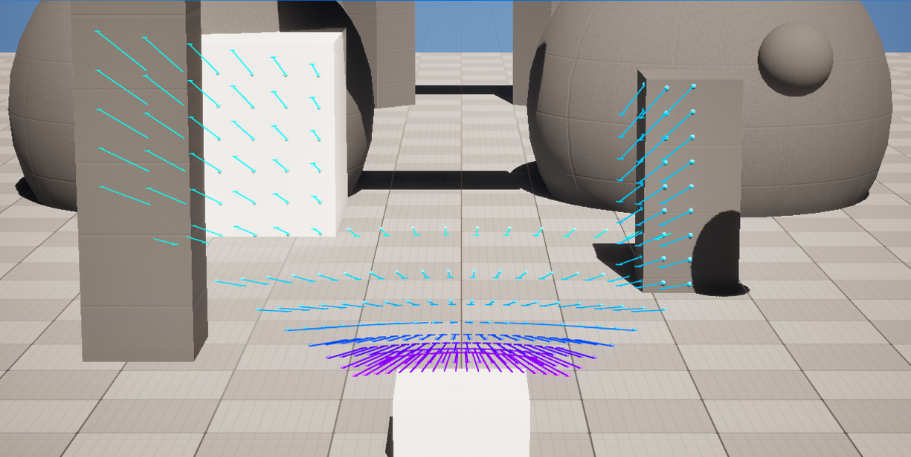
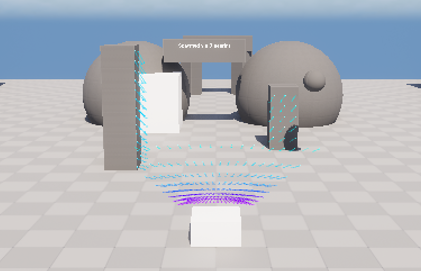

# GEMSTAR UE_Radar_Feature

[](https://www.dlr.de/en/ts/about-us/the-institute-of-transportation-systems)

The `ue_radar_feature` provides a geomitrical ray-casting-based Radar sensor simulation for GEMSTAR in Unreal Engine.
The sensor generates a configurable grid of Radar rays, performs line traces against the unreal scene, and represents detected reflections in an OSI `SensorView`.




## Output
- OSI Sensor View

# Getting started
First clone the GEMSTAR Interfaces plugin inside the Plugins directory and the `ue_radar_feature` inside Plugins/GameFeatures.

Add the plugin to your Unreal project:
```sh
mkdir Plugins/GameFeatures
cd Plugins/GameFeatures

git clone https://github.com/DLR-TS/ue_radar_feature.git
```
Alternatively, add the piugin as a Git submodule:
```sh
git submodule add https://github.com/DLR-TS/ue_radar_feature.git
```

# Configuration
In `Simulation/DefaultGemstar.ini` within the `ue_radar_feature` section:

```ini
[ue_radar_feature:sensor2]
;Debug=true
Mount=SensorPlatform_1
MountingPositionX=-260
MountingPositionY=0
MountingPositionZ=70
MountingOrientationRoll=0
MountingOrientationPitch=0
MountingOrientationYaw=180
FoVHorizontal=180
FoVVertical=20
NumberOfRaysHorizontal=200
NumberOfRaysVertical=10
;simulated view distance in m
Range=100
;NoFalloff is reflection shall be 100%
NoFalloff=true
;DistanceHalfFalloff for simple model: check?
DistanceHalfFalloff=60
```
# Test



A test map is provided with a moving object that moves through a course of different objects.
Open in Unreal editor `/ue_radar_feature/Test/RadarTestMap` and press Play. The test map also contains the manager for the pointcloud visualization to show the impact of the intensity model.

---------------
**Contact:** opensource-ts@dlr.de

This project uses the Open Simulation Interface ([OSI](https://github.com/OpenSimulationInterface/open-simulation-interface)), which is licensed under the
Mozilla Public License 2.0.